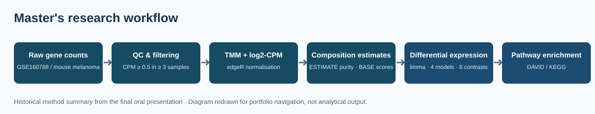
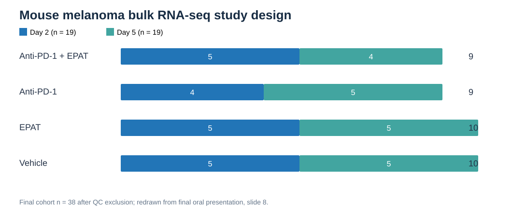
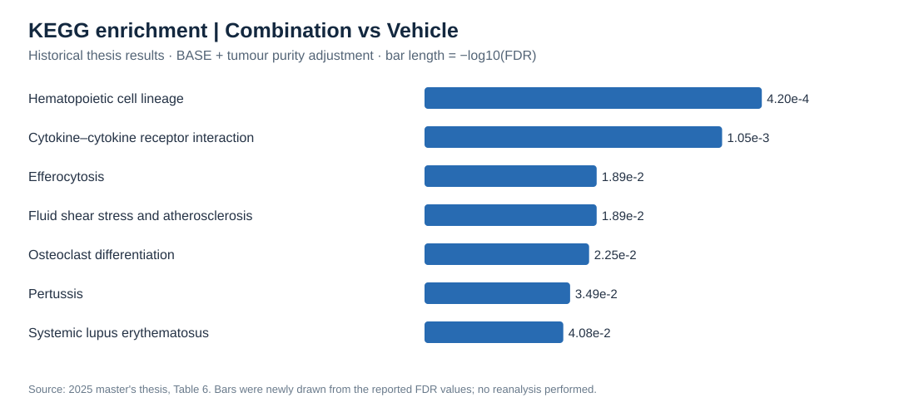
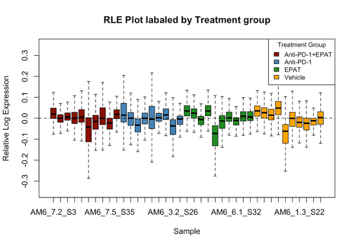
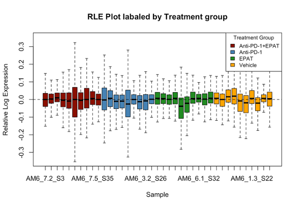

# Exploring Differential Gene Expression in Melanoma Under Combined Checkpoint Inhibitor and Anti-inflammatory Treatment

**Master of Bioinformatics research project | University of Melbourne | 2025**

An archived and organised collection of R code and methods from a master's research project investigating gene-expression changes following anti-PD-1, EP2/EP4 antagonist (EPAT), and combination treatments in a mouse melanoma model.

## Research question

How do combination immunotherapy and EP2/EP4 antagonism influence the tumour microenvironment and differential gene expression, and how does accounting for estimated immune composition and tumour purity affect the results?

## Data and study design

- Public bulk RNA-seq dataset: [GSE160788](https://www.ncbi.nlm.nih.gov/geo/query/acc.cgi?acc=GSE160788) / [PRJNA674507](https://www.ncbi.nlm.nih.gov/bioproject/PRJNA674507).
- Four conditions: Vehicle, anti-PD-1, EPAT, and anti-PD-1 + EPAT.
- Day 2 and day 5 collection; 39 original samples, 38 retained for downstream comparisons following QC.
- Final gene-filtering criterion: CPM >= 0.5 in at least 3 samples. The thesis reports 14,917 genes retained.

## Visual overview of the analysis

*Portfolio diagram drawn from the final oral presentation's documented workflow. This is a methodological illustration, not a new computation.*

## Final oral presentation highlights

The final oral presentation provides a compact narrative of the research. The repository displays redrawn workflow/cohort/KEGG summary SVGs alongside **66 original author-uploaded research and appendix PNGs**, preserved separately in the [original image gallery](docs/original-figures-gallery.md).

*Final analysis cohort: 38 mice across four treatments. Redrawn from final oral presentation slide 8. The slide's displayed day-column total conflicts with the sum of its group rows; the diagram uses the group-level counts and flags that discrepancy in the [presentation notes](docs/oral-presentation-figures.md).*

**Original research figure panels selected from the presentation:**

- **Slide 10 — RLE:** Raw, CPM-only and CPM+TMM expression distributions.
- **Slide 11 — PCA:** Treatment, library size and tumour-purity patterns before and after normalisation.
- **Slide 12 — Tumour microenvironment:** ESTIMATE purity and BASE immune-cell enrichment heatmap.
- **Slide 14 — Differential expression:** Four volcano panels comparing Model 4 (unadjusted) with Model 1 (BASE + purity), including positive and negative controls.
- **Slide 15 — P-value distributions:** Adjusted vs unadjusted combination-versus-vehicle contrast.
- **Slide 16 — Pathway enrichment:** Reported DAVID/KEGG table and comparative pathway-effect plot.

The author has now uploaded original research and appendix PNGs. They are indexed without guessed figure identities in the [original image gallery](docs/original-figures-gallery.md). See the [presentation figure notes](docs/oral-presentation-figures.md) for the authoritative slide-to-figure descriptions.

## Featured historical results

*Visual summary newly redrawn from the thesis Table 6, not a new enrichment analysis. These seven pathways passed FDR < 0.05 in the combination vs vehicle comparison under the BASE + tumour-purity-adjusted model.*

The final reported workflow retained **14,917 genes** after filtering (CPM >= 0.5 in at least three samples) and included **38 samples** after removal of the QC outlier. For the combination vs vehicle contrast, the thesis recorded **682 differentially expressed genes** meeting |log2FC| > 0.585 and nominal p < 0.05 in the BASE + purity model, followed by DAVID/KEGG overrepresentation analysis. The thesis reports broader signals without adjustment; this is an observation, not proof that all unadjusted genes are false positives.

**Other original figures:** Original uploaded research images, including appendix supplementary outputs, are now available in the [66-image gallery](docs/original-figures-gallery.md). Original pixels are preserved; filenames are now stable sequential archive identifiers pending panel-by-panel caption verification.

## Selected software and methods

**R / Bioconductor:** edgeR (TMM / CPM), EDASeq (RLE), limma (differential expression), biomaRt (gene mapping), ESTIMATE (tumour purity), immunedeconv (BASE and alternative deconvolution methods), ggplot2 (figures). **Pathway interpretation:** DAVID Functional Annotation Tool and KEGG. This is a summary of tools used in the research, not a claim that every package in the historical R session was part of the final method.

**Provenance:** Analysis of publicly available data from [GSE160788](https://www.ncbi.nlm.nih.gov/geo/query/acc.cgi?acc=GSE160788), as reported in the 2025 master's thesis. The experimental source is Pelly et al. (2021); cite the original study and software publications if reusing this analysis.

**Recorded R environment:** The author also retained an R 4.4.1 session snapshot with versions of key packages (including edgeR, limma, immunedeconv and biomaRt). See [software and dependencies](docs/software-and-dependencies.md). This is an environment record, not a fully reproducible lockfile.

## Research workflow

1. Raw count review, low-expression filtering, and TMM-normalised log2-CPM.
2. Quality control and sample exploration using PCA and RLE plots.
3. ESTIMATE tumour purity after mouse-to-human ortholog conversion.
4. Exploration of immune deconvolution methods; **BASE** selected for the principal final adjustment approach, rather than quanTIseq.
5. Positive/negative control gene checks.
6. Differential expression with limma, contrasting treatment effects under different combinations of BASE and tumour purity covariates.
7. KEGG pathway enrichment interpretation.

This workflow describes the *historical research project*. The R code was used interactively and has not been packaged as a fully executable automated pipeline.

## Code organisation

| Path | What it contains |
| --- | --- |
| [research-notebook/01_preprocessing_qc_estimate.R](research-notebook/01_preprocessing_qc_estimate.R) | Original sections on preprocessing, QC, and ESTIMATE |
| [research-notebook/02_control_genes_and_exploration.R](research-notebook/02_control_genes_and_exploration.R) | Original sections on control genes and explorations (including RUV attempts) |
| [research-notebook/03_immune_deconvolution.R](research-notebook/03_immune_deconvolution.R) | Original section comparing deconvolution approaches |
| [research-notebook/04_limma_and_visualisation.R](research-notebook/04_limma_and_visualisation.R) | Original sections on limma models, volcano plots, and statistical visualisation |
| [archive/original_annotated_code.R](archive/original_annotated_code.R) | Complete original annotated R file, preserved as submitted |
| [docs/base-selection.md](docs/base-selection.md) | Notes on the selection of BASE over quanTIseq |
| [docs/methodology.md](docs/methodology.md) | Methodological notes |

The notebook files are **reorganised excerpts of the original code**, not rewritten replacements. Their internal exploratory snippets, overwritten variables, and dependencies on objects from previous R sessions have been preserved to avoid rewriting research history. They are for code review and portfolio demonstration; **do not assume each file will run independently**.

**Additional original source files:** Nine independent R / R Markdown scripts from the completed study are preserved in the [standalone research archive](archive/standalone-r/README.md), including PCA/RLE QC, outlier handling, housekeeping and positive controls, RUV PRPS and immune deconvolution. These are historic analysis records, not new or fully self-contained runnable pipelines.

## Original research figures

**66 original PNG images are now committed** under [`results/figures/original-uploads/`](results/figures/original-uploads/), including the appendix uploads. The originals are preserved byte-for-byte, and the root directory has been decluttered. See the [complete clickable image gallery](docs/original-figures-gallery.md) and the [supplementary volcano figure guide](docs/supplementary-volcano-gallery.md).

The original files had timestamp filenames and are now consistently named `research-figure-001.png` through `research-figure-066.png`. These archive identifiers avoid asserting an unverified contrast or model; scientific captions can be cross-checked against the thesis and appendix. The [portfolio SVGs](results/figures/) remain clearly distinguished as diagrams/redrawings, not original statistical plots.

## Original figures — preview

View three of the original research PNG uploads

The images below are unmodified author-supplied research files. Their sequential archive filenames do not identify which scientific panel each image depicts. See the [complete 66-image visual gallery](docs/original-figures-gallery.md) and the [appendix S1–S9 figure key](docs/supplementary-volcano-gallery.md) for exploration and methodological context.

## Explore the research

- [Code navigation guide](research-notebook/README.md)
- [Research archive audit: original scripts, overlaps and supporting spreadsheets](docs/research-archive-audit.md)
- [Historical research highlights](docs/results-highlights.md)
- [Editorial code-review notes](docs/code-review-notes.md)
- [All 66 original research and appendix images](docs/original-figures-gallery.md)
- [Supplementary volcano-plot guide and figure provenance](docs/supplementary-volcano-gallery.md)
- [BASE-versus-quanTIseq decision](docs/base-selection.md)

## Principal conclusions

Comparisons with and without immune composition/tumour purity adjustment highlighted the influence of sample composition on apparent treatment-associated expression changes. The study explored immune and inflammatory pathways associated with different treatment combinations. See the submitted thesis and appendix for the full results and limitations. These findings are from the original master's research, not a new re-analysis.

## Reproducibility and attribution

The original analysis relied on an interactive RStudio environment. This repository presents and organises the existing work, but does not claim a verified, one-command reproduction of all figures or statistics. Public datasets are linked rather than redistributed, and the original study and software authors should be cited when reusing the work.

The complete thesis and supervisor meeting slides are not automatically republished here. Please contact the author for further methodological context. No software licence has been selected.
