# Original research images — 66-figure gallery

All **66 original research and supplementary PNGs** are hosted in [`results/figures/original-uploads/`](../results/figures/original-uploads/). Figures have stable numbered filenames (`research-figure-001.png` etc.) instead of GitHub's timestamp-based `Pasted …png` names. **The binary image data did not change** during renaming.

**Scientific attribution:** A sequential figure number is an archive identifier, **not** a verified manuscript Figure S number, experimental contrast or analytical method. Refer to the author's thesis and [appendix S1–S9 map](supplementary-volcano-gallery.md) for scientific panel labels.

## Image previews

Research figure 001

[Open full-resolution PNG](../results/figures/original-uploads/research-figure-001.png)

Research figure 002

[Open full-resolution PNG](../results/figures/original-uploads/research-figure-002.png)

Research figure 003

[Open full-resolution PNG](../results/figures/original-uploads/research-figure-003.png)

Research figure 004

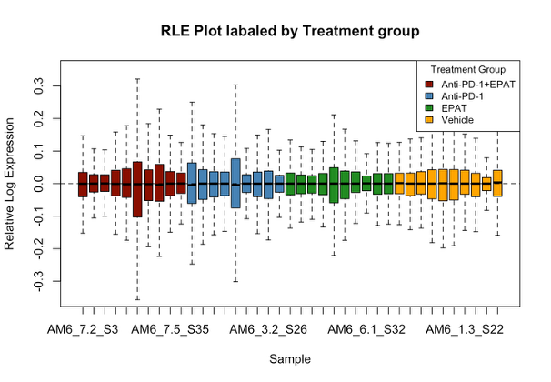

[Open full-resolution PNG](../results/figures/original-uploads/research-figure-004.png)

Research figure 005

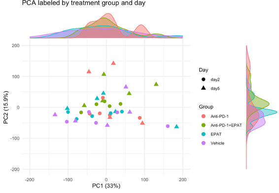

[Open full-resolution PNG](../results/figures/original-uploads/research-figure-005.png)

Research figure 006

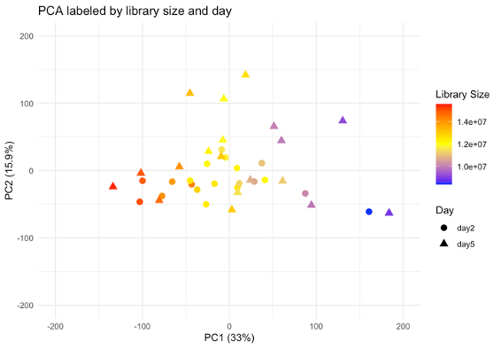

[Open full-resolution PNG](../results/figures/original-uploads/research-figure-006.png)

Research figure 007

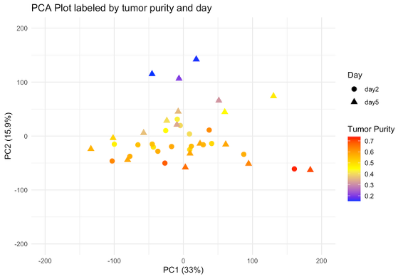

[Open full-resolution PNG](../results/figures/original-uploads/research-figure-007.png)

Research figure 008

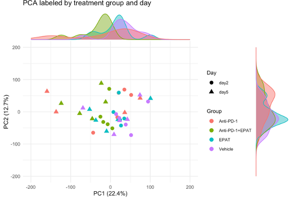

[Open full-resolution PNG](../results/figures/original-uploads/research-figure-008.png)

Research figure 009

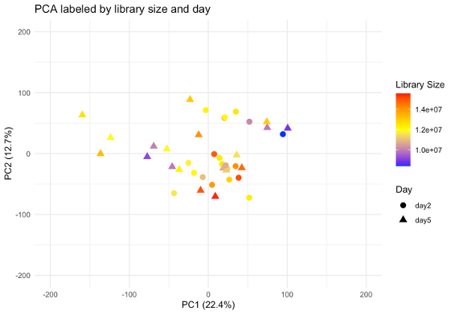

[Open full-resolution PNG](../results/figures/original-uploads/research-figure-009.png)

Research figure 010

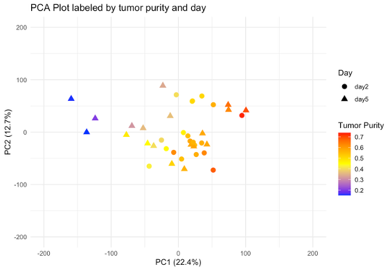

[Open full-resolution PNG](../results/figures/original-uploads/research-figure-010.png)

Research figure 011

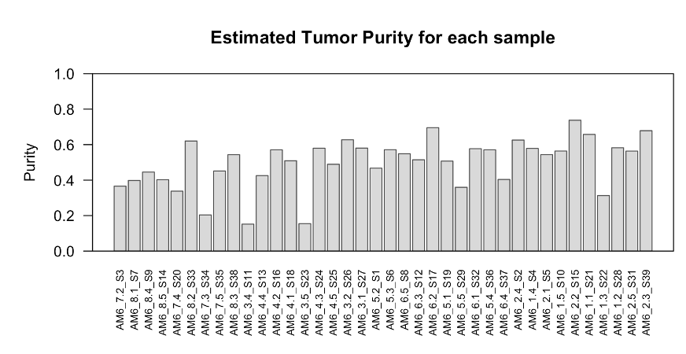

[Open full-resolution PNG](../results/figures/original-uploads/research-figure-011.png)

Research figure 012

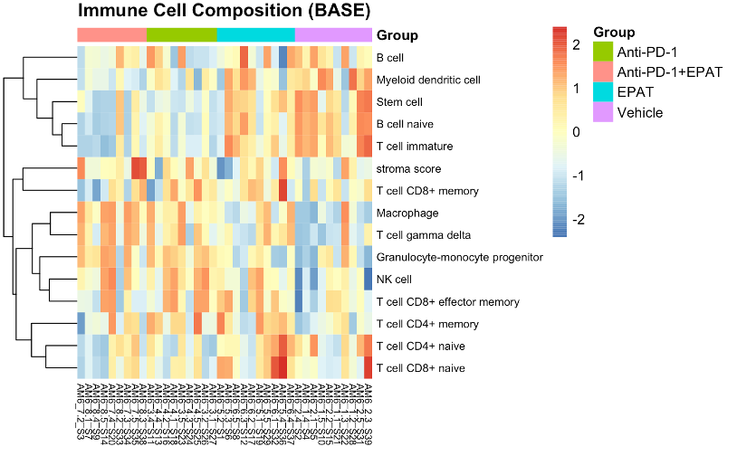

[Open full-resolution PNG](../results/figures/original-uploads/research-figure-012.png)

Research figure 013

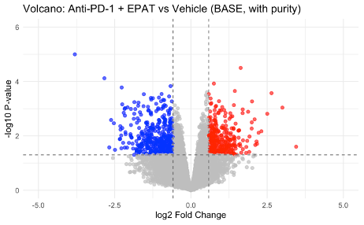

[Open full-resolution PNG](../results/figures/original-uploads/research-figure-013.png)

Research figure 014

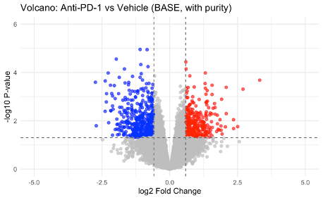

[Open full-resolution PNG](../results/figures/original-uploads/research-figure-014.png)

Research figure 015

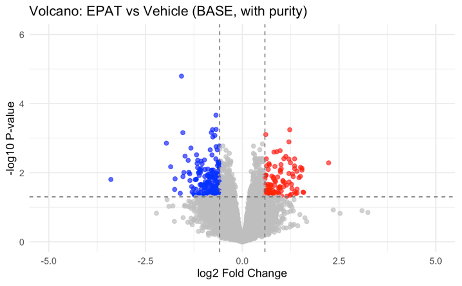

[Open full-resolution PNG](../results/figures/original-uploads/research-figure-015.png)

Research figure 016

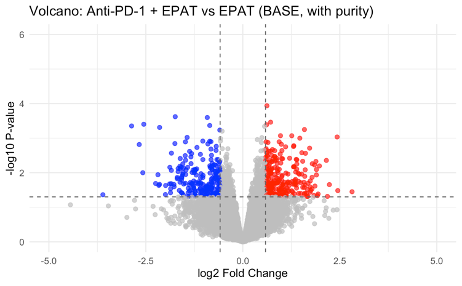

[Open full-resolution PNG](../results/figures/original-uploads/research-figure-016.png)

Research figure 017

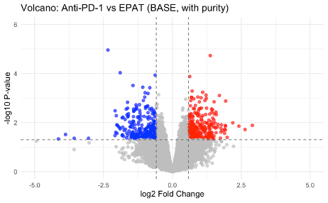

[Open full-resolution PNG](../results/figures/original-uploads/research-figure-017.png)

Research figure 018

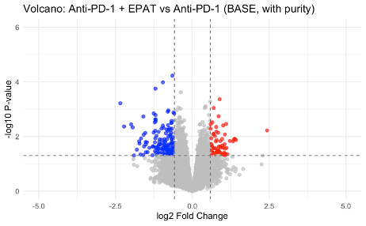

[Open full-resolution PNG](../results/figures/original-uploads/research-figure-018.png)

Research figure 019

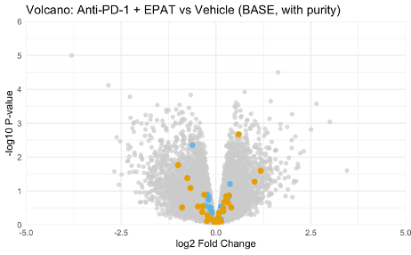

[Open full-resolution PNG](../results/figures/original-uploads/research-figure-019.png)

Research figure 020

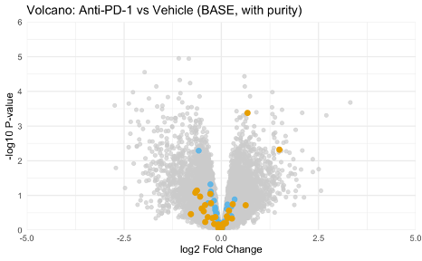

[Open full-resolution PNG](../results/figures/original-uploads/research-figure-020.png)

Research figure 021

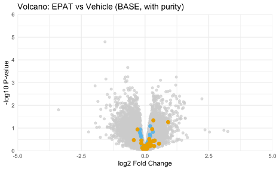

[Open full-resolution PNG](../results/figures/original-uploads/research-figure-021.png)

Research figure 022

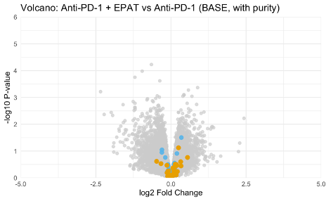

[Open full-resolution PNG](../results/figures/original-uploads/research-figure-022.png)

Research figure 023

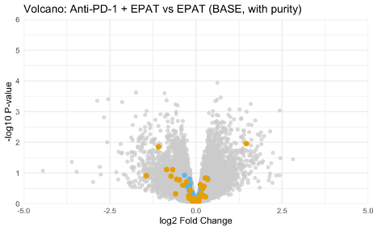

[Open full-resolution PNG](../results/figures/original-uploads/research-figure-023.png)

Research figure 024

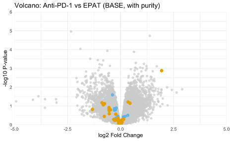

[Open full-resolution PNG](../results/figures/original-uploads/research-figure-024.png)

Research figure 025

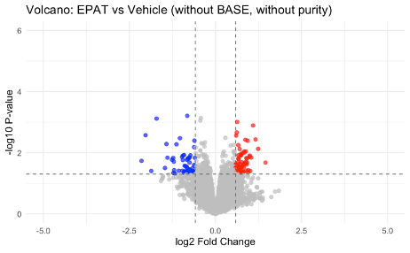

[Open full-resolution PNG](../results/figures/original-uploads/research-figure-025.png)

Research figure 026

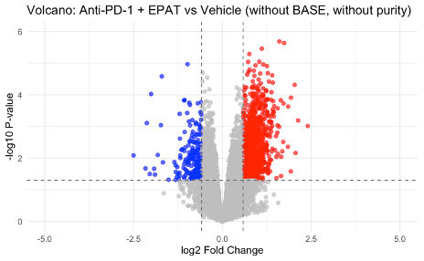

[Open full-resolution PNG](../results/figures/original-uploads/research-figure-026.png)

Research figure 027

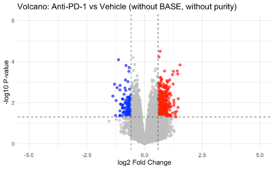

[Open full-resolution PNG](../results/figures/original-uploads/research-figure-027.png)

Research figure 028

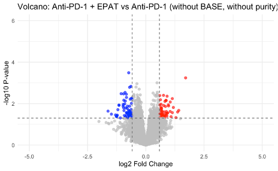

[Open full-resolution PNG](../results/figures/original-uploads/research-figure-028.png)

Research figure 029

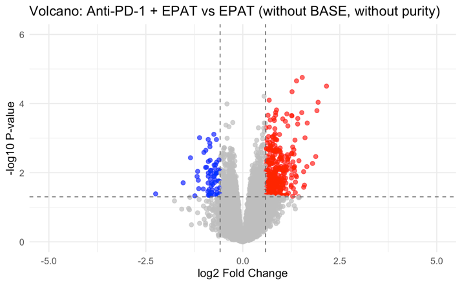

[Open full-resolution PNG](../results/figures/original-uploads/research-figure-029.png)

Research figure 030

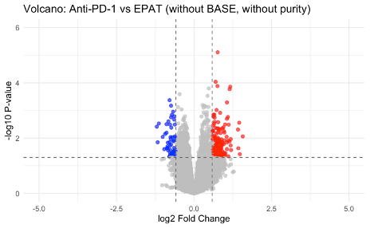

[Open full-resolution PNG](../results/figures/original-uploads/research-figure-030.png)

Research figure 031

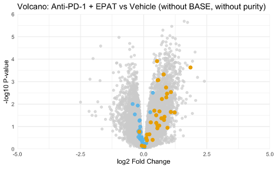

[Open full-resolution PNG](../results/figures/original-uploads/research-figure-031.png)

Research figure 032

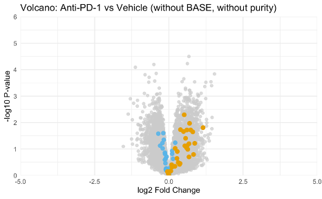

[Open full-resolution PNG](../results/figures/original-uploads/research-figure-032.png)

Research figure 033

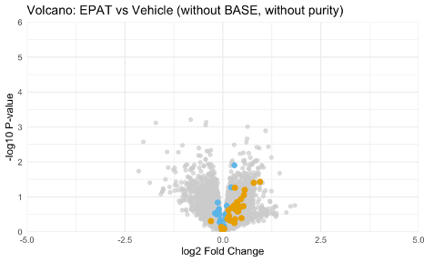

[Open full-resolution PNG](../results/figures/original-uploads/research-figure-033.png)

Research figure 034

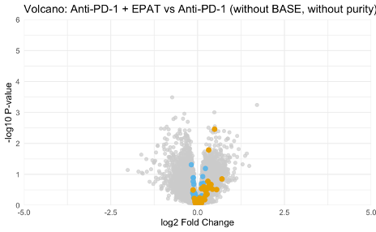

[Open full-resolution PNG](../results/figures/original-uploads/research-figure-034.png)

Research figure 035

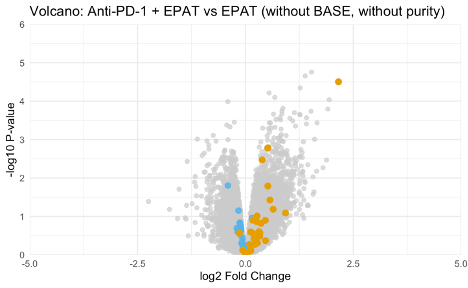

[Open full-resolution PNG](../results/figures/original-uploads/research-figure-035.png)

Research figure 036

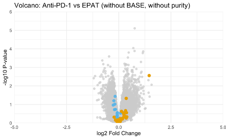

[Open full-resolution PNG](../results/figures/original-uploads/research-figure-036.png)

Research figure 037

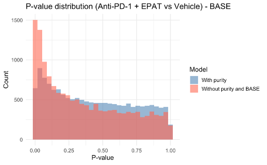

[Open full-resolution PNG](../results/figures/original-uploads/research-figure-037.png)

Research figure 038

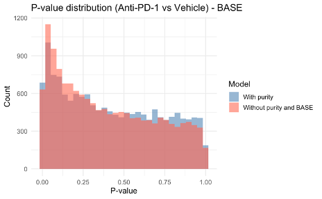

[Open full-resolution PNG](../results/figures/original-uploads/research-figure-038.png)

Research figure 039

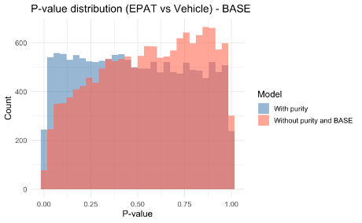

[Open full-resolution PNG](../results/figures/original-uploads/research-figure-039.png)

Research figure 040

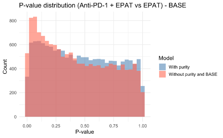

[Open full-resolution PNG](../results/figures/original-uploads/research-figure-040.png)

Research figure 041

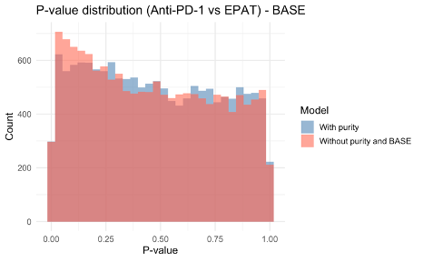

[Open full-resolution PNG](../results/figures/original-uploads/research-figure-041.png)

Research figure 042

[Open full-resolution PNG](../results/figures/original-uploads/research-figure-042.png)

Research figure 043

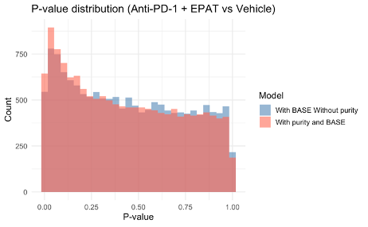

[Open full-resolution PNG](../results/figures/original-uploads/research-figure-043.png)

Research figure 044

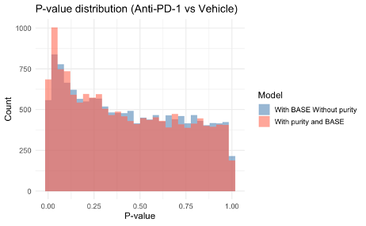

[Open full-resolution PNG](../results/figures/original-uploads/research-figure-044.png)

Research figure 045

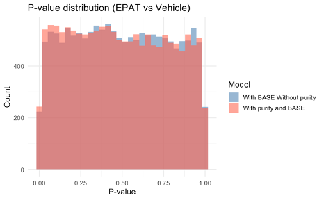

[Open full-resolution PNG](../results/figures/original-uploads/research-figure-045.png)

Research figure 046

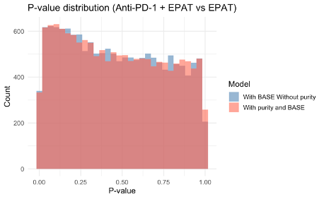

[Open full-resolution PNG](../results/figures/original-uploads/research-figure-046.png)

Research figure 047

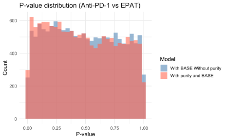

[Open full-resolution PNG](../results/figures/original-uploads/research-figure-047.png)

Research figure 048

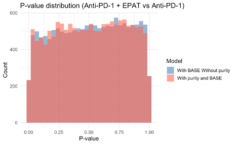

[Open full-resolution PNG](../results/figures/original-uploads/research-figure-048.png)

Research figure 049

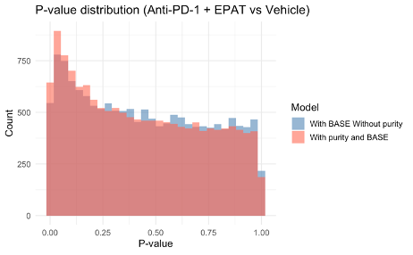

[Open full-resolution PNG](../results/figures/original-uploads/research-figure-049.png)

Research figure 050

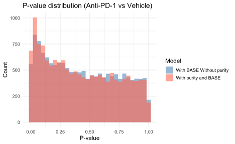

[Open full-resolution PNG](../results/figures/original-uploads/research-figure-050.png)

Research figure 051

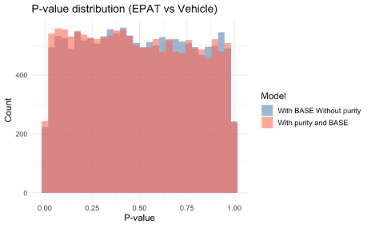

[Open full-resolution PNG](../results/figures/original-uploads/research-figure-051.png)

Research figure 052

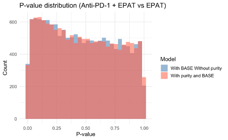

[Open full-resolution PNG](../results/figures/original-uploads/research-figure-052.png)

Research figure 053

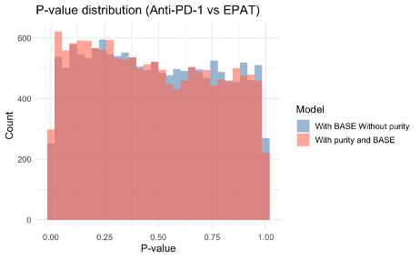

[Open full-resolution PNG](../results/figures/original-uploads/research-figure-053.png)

Research figure 054

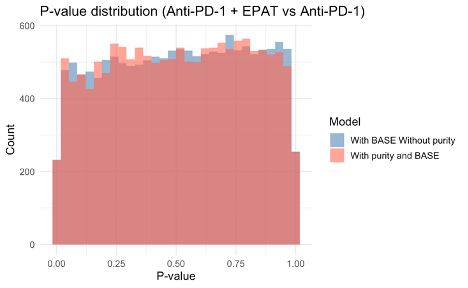

[Open full-resolution PNG](../results/figures/original-uploads/research-figure-054.png)

Research figure 055

[Open full-resolution PNG](../results/figures/original-uploads/research-figure-055.png)

Research figure 056

[Open full-resolution PNG](../results/figures/original-uploads/research-figure-056.png)

Research figure 057

[Open full-resolution PNG](../results/figures/original-uploads/research-figure-057.png)

Research figure 058

[Open full-resolution PNG](../results/figures/original-uploads/research-figure-058.png)

Research figure 059

[Open full-resolution PNG](../results/figures/original-uploads/research-figure-059.png)

Research figure 060

[Open full-resolution PNG](../results/figures/original-uploads/research-figure-060.png)

Research figure 061

[Open full-resolution PNG](../results/figures/original-uploads/research-figure-061.png)

Research figure 062

[Open full-resolution PNG](../results/figures/original-uploads/research-figure-062.png)

Research figure 063

[Open full-resolution PNG](../results/figures/original-uploads/research-figure-063.png)

Research figure 064

[Open full-resolution PNG](../results/figures/original-uploads/research-figure-064.png)

Research figure 065

[Open full-resolution PNG](../results/figures/original-uploads/research-figure-065.png)

Research figure 066

[Open full-resolution PNG](../results/figures/original-uploads/research-figure-066.png)

## Provenance and interpretation

- The RLE, PCA, ESTIMATE purity, BASE enrichment, limma volcano comparisons, p-value distributions and KEGG figures were supplied by the author as historical thesis outputs.
- Additional appendix images cover six treatment contrasts and alternative covariate models, including highlighted control genes.
- The portfolio charts in [`results/figures/`](../results/figures/) are separately redrawn SVG summaries, not replacements for these author-uploaded PNGs.
- The original images were renamed solely for repository navigation; no new statistical analysis was performed.
