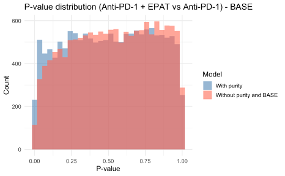

# Original research figures — browsable gallery

**66 original PNG files**, uploaded by the researcher, are stored in [`results/figures/original-uploads/`](../results/figures/original-uploads/). The image bytes were retained unchanged.

These include quality-control and normalisation visualisations, tumour-purity / immune-cell analyses, original differential-expression outputs and supplementary appendix plots. The upload's default `Pasted ...` filenames do not encode a scientific contrast or model. The gallery therefore uses neutral file-based captions; scientific interpretation and panel labels should be taken from the thesis and appendix, not inferred from timestamps.

## Original image preview

Figure 01 — image.png

[Open original PNG](../results/figures/original-uploads/image.png)

Figure 02 — Pasted 2026-10-26 at 12.36.20 PM.png

[Open original PNG](../results/figures/original-uploads/Pasted%202026-10-26%20at%2012.36.20%20PM.png)

Figure 03 — Pasted 2026-10-26 at 12.36.25 PM.png

[Open original PNG](../results/figures/original-uploads/Pasted%202026-10-26%20at%2012.36.25%20PM.png)

Figure 04 — Pasted 2026-10-26 at 12.36.27 PM.png

[Open original PNG](../results/figures/original-uploads/Pasted%202026-10-26%20at%2012.36.27%20PM.png)

Figure 05 — Pasted 2026-10-26 at 12.36.58 PM.png

[Open original PNG](../results/figures/original-uploads/Pasted%202026-10-26%20at%2012.36.58%20PM.png)

Figure 06 — Pasted 2026-10-26 at 12.37.00 PM.png

[Open original PNG](../results/figures/original-uploads/Pasted%202026-10-26%20at%2012.37.00%20PM.png)

Figure 07 — Pasted 2026-10-26 at 12.37.02 PM.png

[Open original PNG](../results/figures/original-uploads/Pasted%202026-10-26%20at%2012.37.02%20PM.png)

Figure 08 — Pasted 2026-10-26 at 12.37.05 PM.png

[Open original PNG](../results/figures/original-uploads/Pasted%202026-10-26%20at%2012.37.05%20PM.png)

Figure 09 — Pasted 2026-10-26 at 12.37.07 PM.png

[Open original PNG](../results/figures/original-uploads/Pasted%202026-10-26%20at%2012.37.07%20PM.png)

Figure 10 — Pasted 2026-10-26 at 12.37.09 PM.png

[Open original PNG](../results/figures/original-uploads/Pasted%202026-10-26%20at%2012.37.09%20PM.png)

Figure 11 — Pasted 2026-10-26 at 12.37.12 PM.png

[Open original PNG](../results/figures/original-uploads/Pasted%202026-10-26%20at%2012.37.12%20PM.png)

Figure 12 — Pasted 2026-10-26 at 12.37.14 PM.png

[Open original PNG](../results/figures/original-uploads/Pasted%202026-10-26%20at%2012.37.14%20PM.png)

Figure 13 — Pasted 2026-10-26 at 12.37.41 PM.png

[Open original PNG](../results/figures/original-uploads/Pasted%202026-10-26%20at%2012.37.41%20PM.png)

Figure 14 — Pasted 2026-10-26 at 12.37.44 PM.png

[Open original PNG](../results/figures/original-uploads/Pasted%202026-10-26%20at%2012.37.44%20PM.png)

Figure 15 — Pasted 2026-10-26 at 12.37.45 PM.png

[Open original PNG](../results/figures/original-uploads/Pasted%202026-10-26%20at%2012.37.45%20PM.png)

Figure 16 — Pasted 2026-10-26 at 12.37.47 PM.png

[Open original PNG](../results/figures/original-uploads/Pasted%202026-10-26%20at%2012.37.47%20PM.png)

Figure 17 — Pasted 2026-10-26 at 12.37.49 PM.png

[Open original PNG](../results/figures/original-uploads/Pasted%202026-10-26%20at%2012.37.49%20PM.png)

Figure 18 — Pasted 2026-10-26 at 12.37.51 PM.png

[Open original PNG](../results/figures/original-uploads/Pasted%202026-10-26%20at%2012.37.51%20PM.png)

Figure 19 — Pasted 2026-10-26 at 12.37.54 PM.png

[Open original PNG](../results/figures/original-uploads/Pasted%202026-10-26%20at%2012.37.54%20PM.png)

Figure 20 — Pasted 2026-10-26 at 12.37.57 PM.png

[Open original PNG](../results/figures/original-uploads/Pasted%202026-10-26%20at%2012.37.57%20PM.png)

Figure 21 — Pasted 2026-10-26 at 12.38.00 PM.png

[Open original PNG](../results/figures/original-uploads/Pasted%202026-10-26%20at%2012.38.00%20PM.png)

Figure 22 — Pasted 2026-10-26 at 12.38.02 PM.png

[Open original PNG](../results/figures/original-uploads/Pasted%202026-10-26%20at%2012.38.02%20PM.png)

Figure 23 — Pasted 2026-10-26 at 12.38.05 PM.png

[Open original PNG](../results/figures/original-uploads/Pasted%202026-10-26%20at%2012.38.05%20PM.png)

Figure 24 — Pasted 2026-10-26 at 12.38.14 PM.png

[Open original PNG](../results/figures/original-uploads/Pasted%202026-10-26%20at%2012.38.14%20PM.png)

Figure 25 — Pasted 2026-10-26 at 12.38.17 PM.png

[Open original PNG](../results/figures/original-uploads/Pasted%202026-10-26%20at%2012.38.17%20PM.png)

Figure 26 — Pasted 2026-10-26 at 12.38.19 PM.png

[Open original PNG](../results/figures/original-uploads/Pasted%202026-10-26%20at%2012.38.19%20PM.png)

Figure 27 — Pasted 2026-10-26 at 12.38.23 PM.png

[Open original PNG](../results/figures/original-uploads/Pasted%202026-10-26%20at%2012.38.23%20PM.png)

Figure 28 — Pasted 2026-10-26 at 12.38.25 PM.png

[Open original PNG](../results/figures/original-uploads/Pasted%202026-10-26%20at%2012.38.25%20PM.png)

Figure 29 — Pasted 2026-10-26 at 12.38.27 PM.png

[Open original PNG](../results/figures/original-uploads/Pasted%202026-10-26%20at%2012.38.27%20PM.png)

Figure 30 — Pasted 2026-10-26 at 12.38.28 PM.png

[Open original PNG](../results/figures/original-uploads/Pasted%202026-10-26%20at%2012.38.28%20PM.png)

Figure 31 — Pasted 2026-10-26 at 12.38.31 PM.png

[Open original PNG](../results/figures/original-uploads/Pasted%202026-10-26%20at%2012.38.31%20PM.png)

Figure 32 — Pasted 2026-10-26 at 12.38.34 PM.png

[Open original PNG](../results/figures/original-uploads/Pasted%202026-10-26%20at%2012.38.34%20PM.png)

Figure 33 — Pasted 2026-10-26 at 12.38.36 PM.png

[Open original PNG](../results/figures/original-uploads/Pasted%202026-10-26%20at%2012.38.36%20PM.png)

Figure 34 — Pasted 2026-10-26 at 12.38.38 PM.png

[Open original PNG](../results/figures/original-uploads/Pasted%202026-10-26%20at%2012.38.38%20PM.png)

Figure 35 — Pasted 2026-10-26 at 12.38.40 PM.png

[Open original PNG](../results/figures/original-uploads/Pasted%202026-10-26%20at%2012.38.40%20PM.png)

Figure 36 — Pasted 2026-10-26 at 12.38.42 PM.png

[Open original PNG](../results/figures/original-uploads/Pasted%202026-10-26%20at%2012.38.42%20PM.png)

Figure 37 — Pasted 2026-10-26 at 12.38.45 PM.png

[Open original PNG](../results/figures/original-uploads/Pasted%202026-10-26%20at%2012.38.45%20PM.png)

Figure 38 — Pasted 2026-10-26 at 12.38.48 PM.png

[Open original PNG](../results/figures/original-uploads/Pasted%202026-10-26%20at%2012.38.48%20PM.png)

Figure 39 — Pasted 2026-10-26 at 12.38.50 PM.png

[Open original PNG](../results/figures/original-uploads/Pasted%202026-10-26%20at%2012.38.50%20PM.png)

Figure 40 — Pasted 2026-10-26 at 12.38.51 PM.png

[Open original PNG](../results/figures/original-uploads/Pasted%202026-10-26%20at%2012.38.51%20PM.png)

Figure 41 — Pasted 2026-10-26 at 12.38.58 PM.png

[Open original PNG](../results/figures/original-uploads/Pasted%202026-10-26%20at%2012.38.58%20PM.png)

Figure 42 — Pasted 2026-10-26 at 12.39.00 PM.png

[Open original PNG](../results/figures/original-uploads/Pasted%202026-10-26%20at%2012.39.00%20PM.png)

Figure 43 — Pasted 2026-10-26 at 12.39.09 PM.png

[Open original PNG](../results/figures/original-uploads/Pasted%202026-10-26%20at%2012.39.09%20PM.png)

Figure 44 — Pasted 2026-10-26 at 12.39.11 PM.png

[Open original PNG](../results/figures/original-uploads/Pasted%202026-10-26%20at%2012.39.11%20PM.png)

Figure 45 — Pasted 2026-10-26 at 12.39.13 PM.png

[Open original PNG](../results/figures/original-uploads/Pasted%202026-10-26%20at%2012.39.13%20PM.png)

Figure 46 — Pasted 2026-10-26 at 12.39.18 PM.png

[Open original PNG](../results/figures/original-uploads/Pasted%202026-10-26%20at%2012.39.18%20PM.png)

Figure 47 — Pasted 2026-10-26 at 12.39.19 PM.png

[Open original PNG](../results/figures/original-uploads/Pasted%202026-10-26%20at%2012.39.19%20PM.png)

Figure 48 — Pasted 2026-10-26 at 12.39.21 PM.png

[Open original PNG](../results/figures/original-uploads/Pasted%202026-10-26%20at%2012.39.21%20PM.png)

Figure 49 — Pasted 2026-10-26 at 12.39.24 PM.png

[Open original PNG](../results/figures/original-uploads/Pasted%202026-10-26%20at%2012.39.24%20PM.png)

Figure 50 — Pasted 2026-10-26 at 12.39.26 PM.png

[Open original PNG](../results/figures/original-uploads/Pasted%202026-10-26%20at%2012.39.26%20PM.png)

Figure 51 — Pasted 2026-10-26 at 12.39.27 PM.png

[Open original PNG](../results/figures/original-uploads/Pasted%202026-10-26%20at%2012.39.27%20PM.png)

Figure 52 — Pasted 2026-10-26 at 12.39.30 PM.png

[Open original PNG](../results/figures/original-uploads/Pasted%202026-10-26%20at%2012.39.30%20PM.png)

Figure 53 — Pasted 2026-10-26 at 12.39.34 PM.png

[Open original PNG](../results/figures/original-uploads/Pasted%202026-10-26%20at%2012.39.34%20PM.png)

Figure 54 — Pasted 2026-10-26 at 12.39.37 PM.png

[Open original PNG](../results/figures/original-uploads/Pasted%202026-10-26%20at%2012.39.37%20PM.png)

Figure 55 — Pasted 2026-10-26 at 12.39.41 PM.png

[Open original PNG](../results/figures/original-uploads/Pasted%202026-10-26%20at%2012.39.41%20PM.png)

Figure 56 — Pasted 2026-10-26 at 12.39.43 PM.png

[Open original PNG](../results/figures/original-uploads/Pasted%202026-10-26%20at%2012.39.43%20PM.png)

Figure 57 — Pasted 2026-10-26 at 12.39.44 PM.png

[Open original PNG](../results/figures/original-uploads/Pasted%202026-10-26%20at%2012.39.44%20PM.png)

Figure 58 — Pasted 2026-10-26 at 12.39.46 PM.png

[Open original PNG](../results/figures/original-uploads/Pasted%202026-10-26%20at%2012.39.46%20PM.png)

Figure 59 — Pasted 2026-10-26 at 12.39.48 PM.png

[Open original PNG](../results/figures/original-uploads/Pasted%202026-10-26%20at%2012.39.48%20PM.png)

Figure 60 — Pasted 2026-10-26 at 12.39.50 PM.png

[Open original PNG](../results/figures/original-uploads/Pasted%202026-10-26%20at%2012.39.50%20PM.png)

Figure 61 — Pasted 2026-10-26 at 12.39.53 PM.png

[Open original PNG](../results/figures/original-uploads/Pasted%202026-10-26%20at%2012.39.53%20PM.png)

Figure 62 — Pasted 2026-10-26 at 12.39.54 PM.png

[Open original PNG](../results/figures/original-uploads/Pasted%202026-10-26%20at%2012.39.54%20PM.png)

Figure 63 — Pasted 2026-10-26 at 12.39.56 PM.png

[Open original PNG](../results/figures/original-uploads/Pasted%202026-10-26%20at%2012.39.56%20PM.png)

Figure 64 — Pasted 2026-10-26 at 12.39.58 PM.png

[Open original PNG](../results/figures/original-uploads/Pasted%202026-10-26%20at%2012.39.58%20PM.png)

Figure 65 — Pasted 2026-10-26 at 12.40.00 PM.png

[Open original PNG](../results/figures/original-uploads/Pasted%202026-10-26%20at%2012.40.00%20PM.png)

Figure 66 — Pasted 2026-10-26 at 12.40.02 PM.png

[Open original PNG](../results/figures/original-uploads/Pasted%202026-10-26%20at%2012.40.02%20PM.png)

## Scientific caption reference

The final presentation associates RLE with slide 10, PCA with slide 11, ESTIMATE and BASE immune scoring with slide 12, treatment-contrast volcano plots with slide 14, p-value distributions with slide 15, and KEGG enrichment with slide 16. Appendix Figures S1–S9 cover further volcano and p-value comparisons. See [presentation figure map](oral-presentation-figures.md), [supplementary plots](supplementary-volcano-gallery.md) and the source dissertation.

**Interpretation:** BASE provides cell-type enrichment scores rather than direct cell fractions. Contrasts with different covariates are model comparisons, not proof of a causal origin of any expression change.
